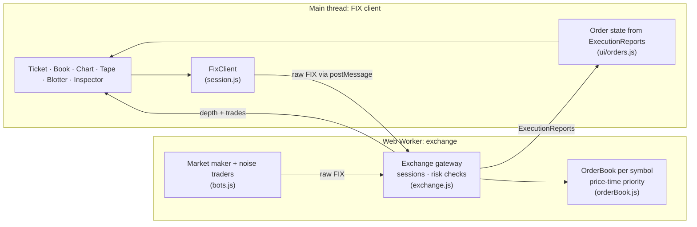

# FIX Flow

[](https://github.com/remikwisniewski/fix-flow/actions/workflows/ci.yml)


A trading simulator that runs entirely in the browser and speaks real **FIX 4.4**. The page is a FIX client, and a Web Worker runs the exchange: a session gateway, pre-trade risk checks, a price-time priority matching engine, and simulated market participants. Every order is a genuine tag=value message with a computed BodyLength and CheckSum, and the built-in inspector decodes any message field by field.

I built it because I onboard market makers onto a derivatives exchange over FIX in my day job, and wanted to show the protocol working end to end rather than describe it.

## What you can do

- **Trade** three simulated symbols against a market maker that quotes ten levels deep and two traders who cross the spread.
- **Watch the wire.** The order ticket shows the exact NewOrderSingle it will send, with BodyLength and CheckSum recomputed as you type.
- **Inspect every message.** Select any message to see its framing check and each tag decoded (`54=1` → Side: Buy).
- **Work orders.** Limit, market and IOC orders, partial fills, cancels, and the full ExecutionReport lifecycle in the blotter.
- **Hit the risk checks.** Unknown symbols, prices outside a 20% band, fat-finger quantities and duplicate ClOrdIDs are all rejected with a reason.
- **Manage the session.** Logon, Heartbeats every HeartBtInt, sequence numbers in both directions, and Logout.

## Messages

| MsgType | Name               | Direction | Notes                                                             |
| ------- | ------------------ | --------- | ----------------------------------------------------------------- |
| `A`     | Logon              | ⇄         | Resets sequence numbers when MsgSeqNum is 1                       |
| `0`     | Heartbeat          | ⇄         | Sent by both sides after HeartBtInt of silence                    |
| `1`     | TestRequest        | →         | Answered with a Heartbeat carrying TestReqID                      |
| `5`     | Logout             | ⇄         |                                                                   |
| `3`     | Reject             | ←         | Bad framing, wrong CompID, sequence gaps, missing or invalid tags |
| `D`     | NewOrderSingle     | →         | Limit and market orders, TimeInForce Day or IOC                   |
| `F`     | OrderCancelRequest | →         |                                                                   |
| `8`     | ExecutionReport    | ←         | New, Trade (partial and full), Canceled, Rejected                 |
| `9`     | OrderCancelReject  | ←         | Unknown order, or too late to cancel                              |

```
8=FIX.4.4|9=127|35=D|49=YOU|56=FIXFLOW|34=2|52=20261019-20:28:04.978|11=YOU-1|55=AAPL|54=1|
60=20261019-20:28:04.978|38=100|40=2|44=187.24|59=0|10=131|
```

## Architecture



Design decisions:

- **Prices are integer cents** inside the engine, so matching never hits floating-point rounding. They only become decimals on the wire.
- **The engine is pure.** `src/engine` has no timers and no DOM. The worker drives it on a 300 ms tick and the tests drive it one step at a time.
- **The bots are real FIX clients.** They log on and go through the same gateway, risk checks and matching as you. One test runs 400 ticks and asserts the gateway rejected nothing they sent.
- **Seeded randomness** (mulberry32) makes any simulation reproducible from its seed.
- **The client trusts only the exchange.** The blotter is rebuilt from ExecutionReports, never from what the ticket sent.

## Engineering

- **157 unit tests** (Vitest) at 100% line coverage of the engine and client logic. They include byte-for-byte checks against a published FIX reference message, price-time priority edge cases, session sequencing, every reject path, and whole-market simulation invariants: books never cross, prices stay near their reference, and runs are reproducible.
- **Static types** through JSDoc and TypeScript `checkJs` in strict mode across `src/engine`.
- **ESLint and Prettier**, enforced by a Husky pre-commit hook and in CI.
- **GitHub Actions CI** runs lint, format, type-check, tests with coverage thresholds, and a production build on every push and pull request.
- **Accessible UI:** keyboard navigation in the inspector, labelled controls, live regions for fills and rejects, and `prefers-reduced-motion` respected.

## Run it

Requires Node.js 20.19 or newer.

```bash
npm install
npm run dev
```

| Script             | What it does                             |
| ------------------ | ---------------------------------------- |
| `npm run dev`      | Start the Vite dev server                |
| `npm test`         | Run the test suite                       |
| `npm run coverage` | Tests with a coverage report             |
| `npm run check`    | Lint, format check, type-check and tests |
| `npm run build`    | Production build to `dist/`              |

## Project layout

```
src/
  engine/            pure, typed, worker-safe
    fix.js           codec: encode, parse, BodyLength, CheckSum, prices, timestamps
    dictionary.js    tag names and enum meanings
    session.js       standard header + FixClient
    orderBook.js     price-time priority matching
    exchange.js      session layer, risk checks, ExecutionReports
    bots.js          market maker and noise traders
    random.js        seeded RNG
    simulation.js    wires the market together, one tick at a time
  worker.js          runs the simulation off the main thread
  ui/                panels, order state, formatting
  main.js            the FIX client: session, routing, rendering
tests/               Vitest suites
```

Simulated market only. Prices are not real.

## License

MIT © Remigiusz Wisniewski
